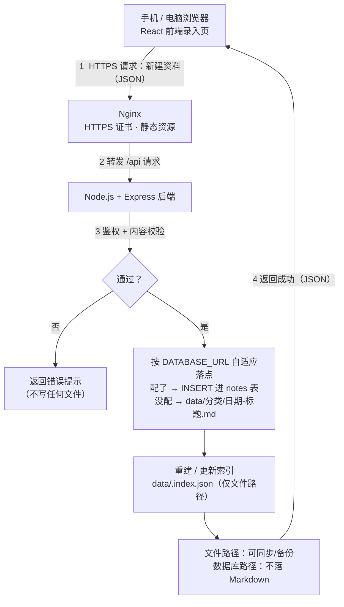
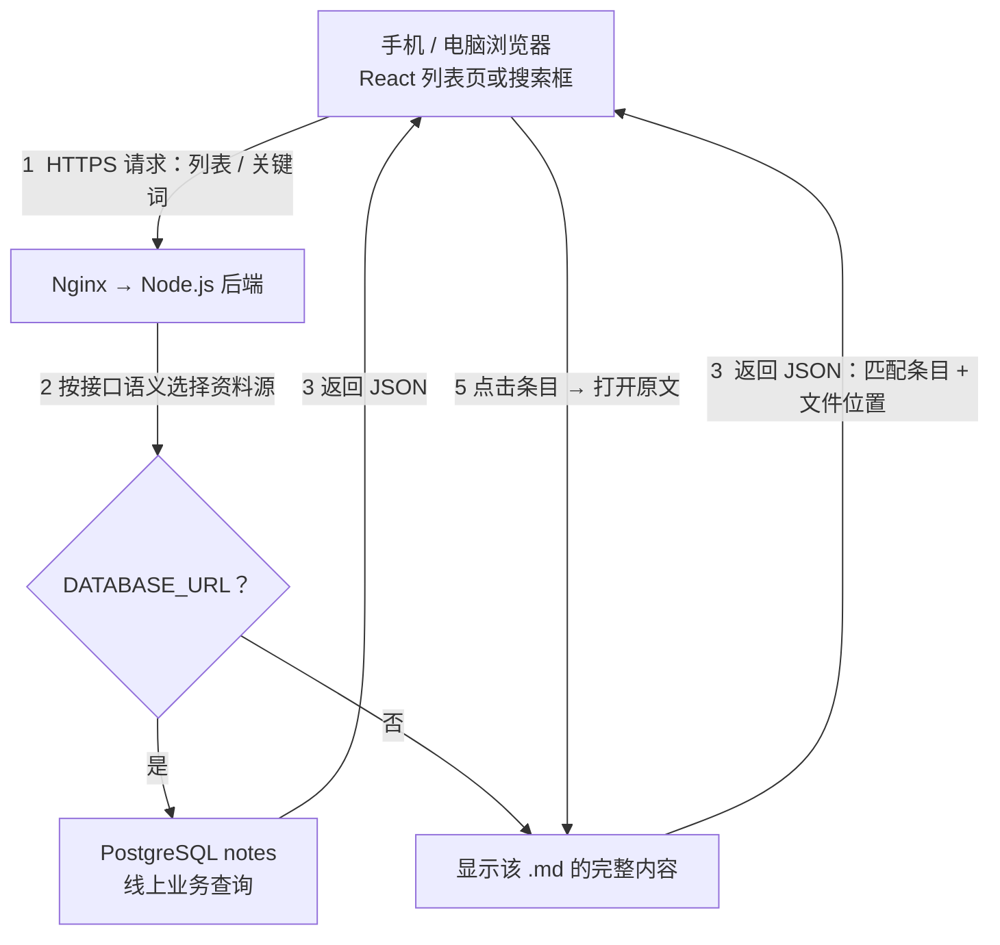
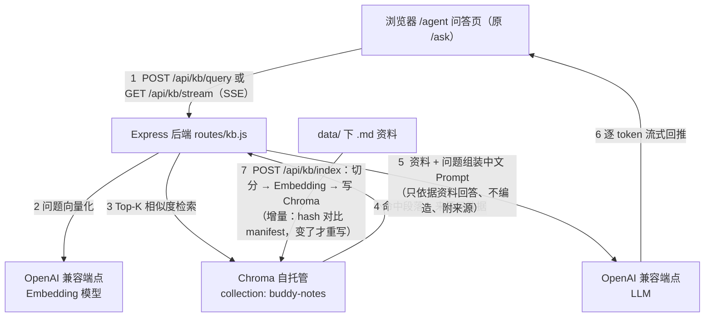
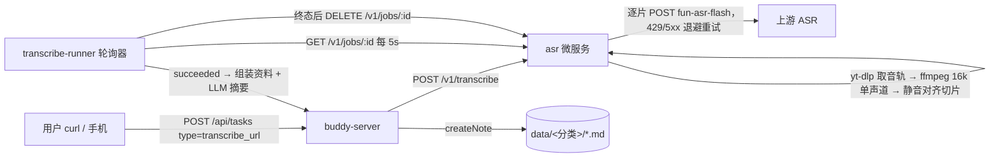
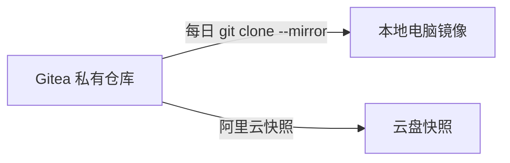
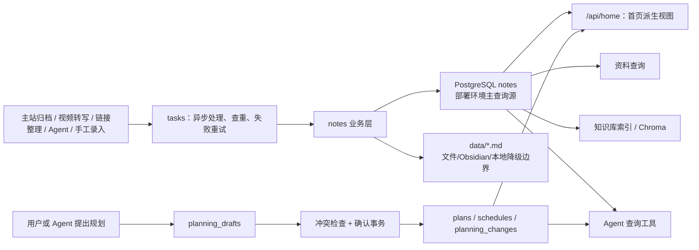
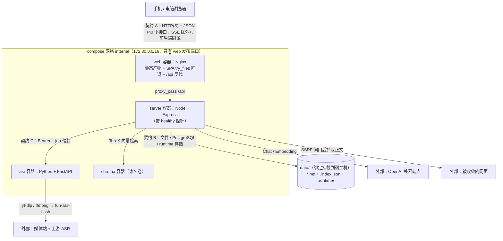
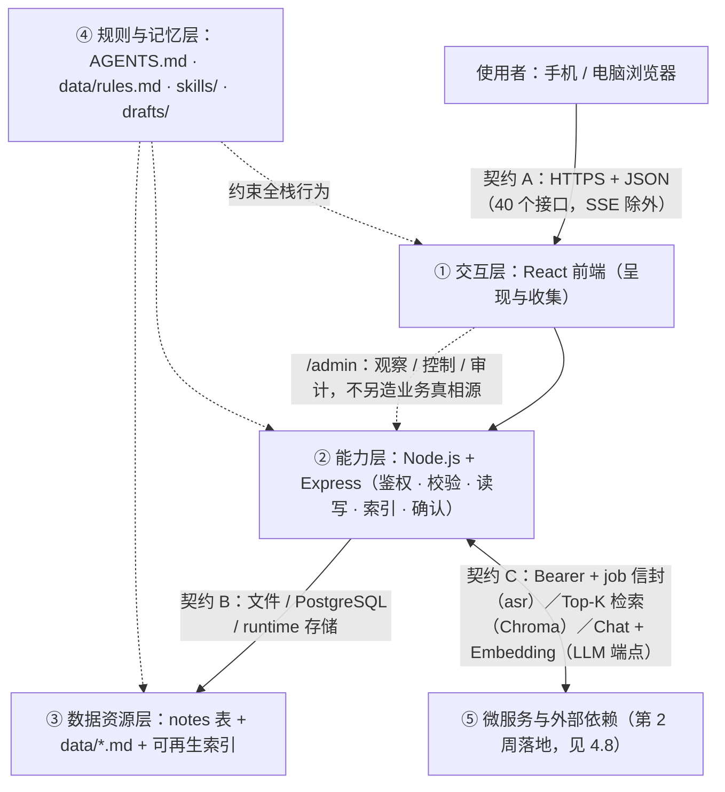

# TECH_DESIGN.md — buddy 技术设计（MVP · 第 1 期）

> 上游依据：`PRD.md` v1.14（F1–F16 与验收标准）。本文只写「为什么这么选」，具体怎么做见 `SPEC.md`。
> 当前版本：v1.9（2026-10-14）｜变更记录见文末第 6 节。
> 原则：能跑通 > 花哨；数据自有 > 平台便利；每层可替换 > 一次到位。

## 1. 设计目标与约束

**要支撑的功能**（2026-10-10 对齐 PRD v1.14）：F1 资料录入 / F2 列表与检索 / F3 索引自动更新 / F4 手机端发起任务 / F5 查看进度 / F6 确认操作 / F7 数据自托管与可迁移 / F9 知识库问答 / F10 深色模式 / F11 关于页 / F12 Agent 工具化（S0+S1+S2-lite 已落地）/ F13 视频音频转写归档 / F14 链接收敛 / F15 ima 云端知识库只读视图 / F15b ima 笔记只读视图 / F16 关于页 × GitHub 动态。**F8（学习留痕）留作第 2 期候选**。

| 约束 | 来源 |
|---|---|
| 单人使用，不做多用户与协作 | PRD 第 2 章 |
| 手机浏览器直接访问，不装客户端；公网 HTTPS | PRD F4、第 5 章 |
| 个人资料存自建私有仓库，公开仓库看不到 | PRD F1、F7、第 5 章 |
| 部署在已有阿里云 ECS（2 vCPU / 4GB） | 现有资源 |
| 资料存储处于文件→PostgreSQL 迁移期；Chroma 向量库始终是派生数据，不是权威副本 | Day 17/18 迁移实现、PRD 第 8 章风险 4 |
| 开发环境：Node 20.19+ / 22.12+ | 两台机器实测 |
| 运行时不止一个进程：`server` 之外还有 asr 微服务与 Chroma，同处 compose `internal` 网络，只有 web 对外开端口 | 第 2 周部署落地（见 4.10） |

## 2. 三层分工

| 层 | 职责 | 对应功能 |
|---|---|---|
| 前端 | 做界面、把输入打包成请求、显示结果 | F1 录入页、F2 列表与搜索页、F5 状态页、F6 确认页、F9 问答页、F10 主题、F11 关于页 |
| 后端 | 鉴权、校验、读写资料、重建索引（唯一守门人） | F1 写文件、F2 读+检索、F3 重建索引、F4/F5/F6 任务与确认、F9 检索生成、F13 转写调度、F14 抓取与提取 |
| 存储 | 资料目录 / PostgreSQL notes / 索引与运行时状态分别承担不同职责；迁移期必须明确真相源 | F7、Day 17/18 迁移 |

**层间契约**：前端与后端只通过 HTTPS 上的 JSON 请求/响应通信（F9、F12 的流式接口用 SSE）；后端与存储通过文件、PostgreSQL、运行时存储和下游服务契约通信。后台属于同一前端中的控制平面，不另造业务数据源；任一层的实现可替换，其他层不用改。

**第 2 周落地后的实际进程**（三层结构不变，多出来的都挂在能力层之下）：

| 进程 / 依赖 | 角色 | 对外暴露 |
|---|---|---|
| `web`（Nginx 容器） | 托管前端静态产物 + 反代 `/api`（同源，Cookie 零跨域配置）+ SPA 回退 | **只有它开端口**（本机/线上 80） |
| `server`（Node + Express） | 上文说的「能力层」，仍是唯一守门人（鉴权 · 校验 · 读写 · 索引 · 确认） | 仅 `internal` 网络 3000 |
| `asr`（Python + FastAPI） | 能力层的下游：把「下载 → 归一化 → 切片 → 逐片转写 → 合并」封成一个 job | 仅 `internal` 网络 8000 |
| `chroma`（Chroma） | 能力层的下游：向量检索（派生数据，可由 `data/` 重建） | 仅 `internal` 网络 8000 |
| 外部端点 | LLM（Chat / Embedding）、上游 ASR、被收敛的网页 | 由能力层按 env 配置访问 |

## 3. 技术路线

| # | 层面 | 选型 | 理由 | 备选与不选原因 |
|---|---|---|---|---|
| 1 | 前端 | React + Vite（响应式，一套页面适配手机与电脑） | 组件化省重复代码；Vite 提供热更新与生产构建 | 原生 HTML/CSS/JS：页面一多就靠复制粘贴，状态管理容易乱 |
| 2 | 前端备选 | —— | —— | Vue：能力相当、上手更平缓；本次选 React 是生态与 AI 生成资料更丰富，要换只换交互层 |
| 3 | 后端 | Node.js + Express | 与前端同一种语言；本机已装 Node | Python + FastAPI：可读性好，但与前端语言割裂 |
| 4 | 数据交互 | REST + JSON over HTTPS | 简单直观、弱网够用、调试方便 | GraphQL：接口少，属过度设计 |
| 5 | 存储 | Markdown 文件 + PostgreSQL notes（迁移期并存）+ 可再生索引 | 兼顾 Obsidian/文件可迁移性与线上查询/聚合；必须显式管理双源边界 | 继续无边界双写：会造成后台、首页、知识库读取不一致 |
| 6 | 列表索引 | 打开列表页时扫描资料目录重建，结果缓存为 JSON | 对应 F3「打开时自动重建」，实现最轻 | 全文搜索引擎：数据量小，无必要 |
| 7 | 登录鉴权 | 单用户口令 + 会话 Cookie（HttpOnly）；隐私模块默认关闭 | 单人使用够用且简单 | OAuth / 第三方登录：只有一个人用，接入不划算 |
| 8 | 运行与部署 | Docker 跑后端 + Nginx 反代并签发证书（Let's Encrypt），部署在阿里云 ECS | 单机可跑、环境干净、迁移容易 | 裸装到系统：依赖散落、升级容易出问题 |
| 9 | 手机端形态 | 响应式网页（无客户端） | 满足 F4「不装客户端」；改一次两端生效 | 原生 App / PWA：需要打包与上架流程，与本期目标无关 |
| 10 | 代码与数据分区 | 代码与文档 → GitHub 公开仓；资料数据 → 自建 Gitea 私有仓 | 打卡验收与隐私兼顾 | 全放一处：全公开泄露隐私，全私有则验收不便 |
| 11 | 备份 | 本地 git mirror + 阿里云快照 | 服务器是单点，必须有第二份 | 只靠服务器磁盘：单点故障即丢数据 |
| 12 | AI 编排（F9） | LangChain.js（`@langchain/core` + `@langchain/openai` + `@langchain/textsplitters`），向量库直连 chromadb 官方客户端 | 流式 API 与 splitter 现成；不引 `@langchain/community`（其 peer 依赖与 dotenv@18 冲突） | LangGraph / 手写 fetch：本期只要检索+生成，图编排是杀鸡用牛刀；手写 fetch 要自造切分与流式轮子 |
| 13 | 向量库（F9） | Chroma 自托管（Docker，token 认证或安全组限源） | 数据自有，符合 F7；向量是派生数据，坏了可由 `data/` 重建 | Chroma Cloud 托管：把资料交给第三方，违背数据自有 |
| 14 | 模型端点（F9） | OpenAI 兼容端点统一供 Chat + Embedding（`OPENAI_BASE_URL` 可切；Embedding 可单独配 `EMBED_BASE_URL`） | 一套代码支持 OpenAI / DashScope 兼容模式 / Ollama，改 env 即换模型 | 锁定某家 SDK：DeepSeek 无 embeddings，双端点设计就是为这个坑留的口子 |
| 15 | 转写服务（F13） | 独立 Python + FastAPI 微服务（`asr/`），fun-asr-flash 多模态端点逐片调用；buddy 侧走任务链路异步推进 | 转写是分钟级长任务且依赖 ffmpeg/yt-dlp，与 Node 后端技术栈不同——独立服务才不拖垮主进程；任务链路复用现成的进度可见与重试语义 | 后端内嵌 Python 子进程：状态管理、限流与清理都黏在主进程；filetrans 异步兜底：本期 fun-asr-flash 已够用，仅留扩展位 |
| 16 | 网页正文提取（F14） | `node-html-parser` + 自写启发式提取（删干扰标签 → 优先 article/main/#content → 取文本最长块） | 零 C 依赖（纯 JS，不引 jsdom 的 20+ 依赖与 DOM 模拟开销）、体积小、提取策略可读可调；对「大部分正常文章页」够用 | `@mozilla/readability`：算法更成熟但依赖 jsdom，为一个「够用就行」的提取器引入完整 DOM 实现不划算——若后期提取质量成为瓶颈，可在 `link.js` 内部把 extractArticle 换成 readability（对外接口不变） |

**第 2 周追加的 4 条（Day 8–13 落地）**：

| # | 层面 | 选型 | 理由 | 备选与不选原因 |
|---|---|---|---|---|
| 17 | 部署编排 | 单机 `docker compose`：`chroma` / `asr` / `server` / `web` 四服务 + 自定义网络 `internal`（只 `web` 发布端口） | 一条命令起全栈、服务间用服务名寻址、临时产物走命名卷（`chroma-data` / `asr-jobs`）；**彩排与上线同一份文件**，避免「本地能跑线上不行」 | 裸装到系统：依赖散落、升级容易炸；K8s / 多云：单人单机属过度设计 |
| 18 | 前端路由与视图状态 | `react-router-dom` v7 + **「地址栏即状态」**（换实体用路径，换视图用查询参数：`?cal=` `?view=` `?tab=` `?mode=`） | 刷新、前进后退、把链接发到手机都保持同一视图；前端不需要额外状态库，也没有「状态与地址不一致」的坑 | 组件内 `useState`：一刷新就回默认视图，分享出去的链接失效 |
| 19 | 主题（F10） | CSS 变量两套 token（`:root` 浅色 + `:root[data-theme='dark']` 深色覆盖）+ `index.html` 首屏内联脚本先定主题 | 零动画、渲染前就定好主题所以不闪浅色；25 个 token 全覆盖后组件里不写死色值，加主题不用动组件 | 多套样式表 / CSS-in-JS：切换要重算样式，硬编码色值容易漏改（本次就回收了 5 处组件里的 9 行写死色值） |
| 20 | 交互反馈（Day 11） | 单例 Toast（`role="status"` 容器**常驻 DOM**）+ 三档反馈口径（即时态 / 短暂提示 / 结果留痕） | 容器常驻读屏才会播报新内容；失败降级不依赖 HTTPS（`navigator.clipboard` 不可用时用 Selection API 自动选中供手动复制） | 各页各写 inline 提示：重复实现、状态容易残留；引 UI 库：为一条提示条引整套组件不划算 |
| 21 | ima 云端接入（F15/F15b） | 同源 BFF 代理（`/api/ima/*` → `ima.qq.com`）+ 进程内 TTL 缓存；前端只打自家接口 | 浏览器直连 ima 会被 CORS 拒（上游不允许 `ima-openapi-*` 自定义头跨源），必须经后端；BFF 顺便藏住 ApiKey、可做缓存与超时收口；**零落盘**靠「只进内存缓存、不写文件」这条硬规矩 | ima 官方 skill（`@tencent-adm/ima-skills`）：面向 CLI agent 场景，buddy 是 Web 应用用不上；前端直连：CORS 被拒 + Key 会进浏览器 |
| 22 | GitHub 动态（F16） | 同源聚合接口 `GET /api/github/activity`（REST profile/events + GraphQL contributionsCalendar）+ 进程内 TTL 缓存（30 分钟）+ 单飞 | 贡献日历 REST 拿不到、必须 GraphQL + PAT——PAT 不能进浏览器所以必须后端代理；三块上游（REST×2 / GraphQL×1）由后端聚成一个出口，前端一次请求拿全；单飞防 TTL 过期瞬间并发打穿上游 | 前端直调 `api.github.com`：未认证 60 次/小时、GraphQL 直接不可用；嵌第三方图床（ghchart 等）：样式不可控、依赖别人服务活着、隐私上把访客的 IP 交给第三方 |

**一句话技术路线**：
> 前端 React（Vite 构建）→ 后端 Node.js + Express（REST/JSON）→ 存储为 Git 仓库里的 Markdown 文件与 JSON 索引 → 部署在阿里云 ECS（Docker + Nginx + HTTPS）。

**为什么「暂时」这么选**：这是在 MVP 与第 2 周目标之间的折中组合，不是最优解，而是「能跑通、且每层都能独立替换」的解。前端选 React 是为第 2 周铺路，代价是首次搭建多一步 `npm install`。

## 4. 数据流图

**权威副本**：代码和文档的权威副本是 GitHub/camp；资料在当前迁移期存在两种落点：部署环境 `notes` 表承担线上业务查询与聚合，Markdown `data/` 保留文件/Obsidian 边界和本地降级路径。Chroma、索引和 runtime 状态都是可再生或运行时数据，不能冒充业务权威副本。资料的长期单一权威源仍是待收敛技术债。

### 4.1 写入链路（F1 / F3）

> Day 18 起 `createNote()` 按 `DATABASE_URL` 自适应：配了就走 notes 表（不落文件、不更新 `.index.json`、不走 git commit——下图中 G/H/I 只在文件路径生效）。SPEC §3.8 写侧小节是这份分叉的契约描述。



### 4.2 读取链路（F2 / F3）



### 4.3 数据从哪来、到哪去

| 数据 | 从哪来 | 到哪去 | 谁负责 |
|---|---|---|---|
| 资料内容 | 主站、任务、Agent 或 Obsidian | 迁移期按 `DATABASE_URL` 落 PostgreSQL 或 `data/` Markdown | 后端资料业务层 |
| 资料索引 | 资料库内容派生 | Chroma / `.index.json`，均可重建 | 后端索引服务 |
| 任务与确认记录 | 使用者提交的任务与点击的确认 | `data/.runtime/*.json` → 私有仓库 | 后端（未确认不执行） |
| 代码与文档 | 开发机 | GitHub 公开仓（本机只推 camp 组织仓） | Git |

### 4.4 RAG 问答链路（F9）



### 4.5 转写链路（F13）



- asr 服务把「下载 → 归一化 → 切片 → 逐片转写 → 按实际片长偏移合并」封成一个 job；buddy 只认 job 信封，不碰 ffmpeg/yt-dlp 细节；
- 单片段最终失败时 job `failed` 但 `error.details.partial` 带已完成片段——buddy 仍归档为「部分转写」资料，不全量白跑；
- 同源结果缓存（TTL 1800s）+ 单飞：重复提交同一 URL 不重新下载、不烧二次 ASR 额度。

**asr 契约现状（2026-10-03 按代码核对，字幕能力落地后更新）**：`PLAN.md` §3 设计 6 个端点，**实现 5 个**——`POST /v1/transcribe`、`GET /v1/jobs/{id}`、`DELETE /v1/jobs/{id}`、`POST /v1/subtitles`（平台字幕抓取：同步返回 `found` + 字幕包含 `text`/`segments`/`srt`）、`GET /healthz`；`formats`/`srt` 参数已实现（`POST /v1/transcribe` 带 `formats:["srt"]` 时 result 附带 `srt`）。**仍未实现** `POST /v1/transcribe/upload`（上传文件转写）与 `GET /v1/tools`（OpenAI function-calling schema）。buddy 侧用到 transcribe / subtitles / jobs 三族（加 `/healthz` 探活），`transcribe_url` 支持「先字幕 → 抓不到回落转写」+ srt 透传落盘；`PLAN.md` 是设计稿（含 F12 agent 工具层规划），读它时以本节为准。

### 4.6 链接收敛链路（F14）

```mermaid
flowchart LR
    U[归档页「收敛」/ 手机] -->|POST /api/tasks type=organize| S[buddy-server]
    S -->|置 doing + task.organize，即时返回 201| U
    S -->|SSRF 闸门：只许公网 http(s)，逐跳重验| N[外部网页]
    N -->|HTML ≤2MB，按 charset 解码| S
    S -->|node-html-parser 剥干扰 → 取正文最长容器| S
    S -->|按 source_url 查重（提交前 + 跳转后各一次）| D[(data/<分类>/*.md)]
    S -->|正文截断 → LLM 摘要/要点（失败回退模板）| L[LLM 端点]
    S -->|createNote| D
    R[organize-runner 兜底轮询] -->|todo 重试 / doing 僵死恢复| S
```

- 抓取与提取是**同步快活儿**（秒级），所以选「提交即执行」而不是像转写那样排队等外部 job；轮询器只做残局兜底（重试与进程重启恢复）；
- SSRF 闸门放在唯一的出站口（`link.js`），重定向逐跳校验——这是本项目第一次主动访问「用户给的地址」，闸门先于功能落地；
- 查重提前到抓取前：同一 URL 二次收敛连请求都不发（既省流量，也符合「不重复处理」铁律）。

### 4.7 备份链路



### 4.8 当前业务信息流（后台规划依据）



### 4.9 后台 control plane

后台与主站共用 Express 和业务接口，不建立第二套业务存储。它分为三种职责：

| 职责 | 观察对象 | 约束 |
|---|---|---|
| 观察 | 服务、任务、资料、规划、Agent、索引 | 读现有接口和聚合数据，不复制统计口径 |
| 控制 | 任务重试、规划确认、站点业务配置 | 复用既有状态迁移、确认闸门和事务 |
| 审计 | Agent runs、规划 changes、确认记录、失败任务 | 只读运行记录，不直接改 runtime 文件 |

Refine/Ant Design 只是后台交互层选型，不改变业务层的数据真相源。规划后台必须调用 `/api/planning/drafts/:id` 的确认链路；资料后台在文件/数据库迁移边界收敛前，不得继续扩大写权限；图片资产和卡片属于后续 CMS 扩展，不提前混入核心信息流。

### 4.10 部署与运行时拓扑（第 2 周落地）



- **对外只有一个门**：`web` 容器发布 80（443 等安全组放行 + 域名就位后再加证书）；`server` 3000、`asr` 8000、`chroma` 8000 都只在 `internal` 网络可达——**向量库与转写服务从根上不裸奔公网**；
- **数据落点**：`data/` 绑定挂载到宿主机（容器写盘直接可见，属主 `bird` / uid 1000，整栈 `down` → `up` 数据仍在）；`chroma-data` 与 `asr-jobs` 用命名卷，后者只放临时媒体与 job JSON（终态即删 + TTL 30 分钟 GC）；
- **网段固定 `172.30.0.0/16`**：本机 sing-box（TUN 模式）会把接口地址设成 `172.18.0.1/30`，与 Docker 默认网段撞车时 `/30` 更具体，导致容器 IP 被当成广播地址、宿主机访问 80 端口被重置（2026-09-26 踩过，容器其实一直 healthy）——这段网段别随手改；
- **线上现状（2026-10-14 核对）**：服务器 **`139.224.192.94`**（阿里云上海，SSH 别名 `fel`），整套 compose 五容器在跑、**`:80` 对外**、`GET /api/health` → `200`；**443 未开、域名尚未解析**（对外用 IP 直连）。原定目标机 `47.85.210.76`（海外 ECS）自 2026-10-14 起 22/80 探测均超时，**从未投入使用**，异地拆分保留为后续选项。本机彩排走 WSL——Windows 侧没有 `docker` 命令。

## 5. 架构原则与演化策略

> 参考课程《生成式软件工程》（NJU）五条主线。本章目标是让「以后重做某一部分」的成本足够低。

### 5.1 架构全景



### 5.2 三条架构原则

| 原则 | 落地 | 好处 |
|---|---|---|
| 关注点分离 | 交互层只呈现、能力层是唯一守门人、后台是 control plane、资源层按对象管理存储 | 改一处不牵动全身；出错容易定位 |
| 接口契约 | 契约 A：HTTPS + JSON（40 个接口，分组见 `SPEC.md` §3）；规划写入必须复用草案/确认事务 | 契约稳定，后台不绕过业务流程 |
| 信息隐藏 + 真相源显式化 | 资料处于文件→PostgreSQL 迁移期；索引、Chroma、runtime 是派生/运行时数据，后台不能隐藏或复制这种分叉 | 先暴露双源边界，再逐步收敛，避免假装不存在一致性问题 |

### 5.3 可替换点（演化轴）

| 变化轴 | 现在 | 可替换为 | 影响范围 |
|---|---|---|---|
| 前端框架 | React + Vite | Vue / 原生 JS | 仅交互层；契约 A 不变 |
| 部署形态 | ECS + Docker + Nginx | CloudBase（本期不走，第 3 周再评估） | 仅部署方式；代码不变 |
| 存储实现 | Git 内 Markdown + JSON 索引 | SQLite / 云数据库 | 仅能力层与资源层之间；前端不变 |

### 5.4 质量属性 → 设计决策

| 质量属性 | 具体设计 | 依据 |
|---|---|---|
| 可靠性 | 外部操作必须先确认（未确认不执行）；登录由后端统一守门 | PRD F6 验收 3 条 |
| 安全性 | 密钥 / `.env` / 连接串永不入库；公网暴露必须 HTTPS | PRD 全局验收、第 5 章 |
| 可移植性 | 纯文本数据 + Git 版本；一条命令即可整体导出 | PRD F7 验收 3 条 |
| 可维护性 | 文档先行（research → PRD → 技术设计）；术语与目录约定统一 | 本文档与 PRD 的对齐检查 |
| 性能（量化） | 检索 ≤2 秒、索引重建 ≤3 秒、页面加载 ≤5 秒（常用网络、资料 ≤100 条） | PRD 第 4 章判定原则 |
| 可追溯性 | 提交标题：打卡提交 `Day X｜一句话`，非打卡的内部改动 `[ BIRD ] | 中文解释`；只用 `git revert` 回退，保留历史 | AGENTS.md §2 五 与 §9.4 |

### 5.5 技术债台账

| 债务 | 为什么现在欠 | 何时偿还 |
|---|---|---|
| 列表索引用「扫描目录重建」 | 数据量小，先求跑通 | 资料上千条或检索明显变慢时 |
| 文件→PostgreSQL 迁移期双源 | 线上查询和文件/Obsidian 边界暂时并存 | 明确生产真相源、统一后台读写与索引来源后 |
| 无自动化测试、无 CI | 单人项目，验收靠文档清单 | 第 4 周（测试与部署阶段） |
| 资料私有仓尚未搭建（Gitea） | 先跑通链路 | 第 3 周 |
| asr 为单进程 + 磁盘 job 状态 | 单机部署够用，不引队列/Redis | 多副本部署时需要共享 job 存储与队列 |
| 转写归档不自动进向量库 | 避免长任务后静默烧 Embedding 额度 | 使用者确认频次后改为索引钩 |
| F14 正文提取是启发式规则 | 自写提取器比 readability 轻得多，正常文章页够用 | 提取成功率明显不足时，在 `link.js` 内换 `@mozilla/readability`（对外接口不变） |
| F14 不做 robots.txt 协商与爬取节流 | 定位是「按需单次抓取自己贴的链接」，不是爬虫 | 真要做批量抓取时，加 robots 解析 + 域名级限速 |
| 转写暂无前端表单入口（只能 curl） | 表单要处理进度、失败重试与退回落待办的交互，先用 curl 把链路验透 | 确定转写表单的交互形态后（同时可一并做上传） |
| asr 的 `upload` / `tools` 端点未实现 | 本期只需要「给 URL 转写」；上传与 agent 工具层属后续期数（F12） | F12 启动时按 `PLAN.md` 落地 |
| 四种状态只覆盖 `/notes` | Day 13 清单只要求列表页，其他页沿用旧写法 | 下一轮前端改动顺带补齐（详情 / 归档 / 日志页） |
| 线上 `:80` 镜像可能落后于代码 | Day 13 收尾时未执行 `docker compose up -d --build web` | ✅ **2026-10-14 已闭环**：使用者重建后公网与本地 dist 指纹一致（`index-C2KIWt9L.js` / `index-ByR0cJlr.css`），五页面全 200 |
| asr 镜像改代码后必须重建 | 容器不会自动同步 `asr/` 源码（2026-09-29 曾出现「整片一段」的假通过） | 改 `asr/` 后一律 `docker compose up -d --build asr` |
| 来源 URL 归一程度有限 | D10 重复入库已修（`normalizeSourceUrl`：去 fragment + 去尾斜杠，保留 query），但**仅覆盖写法差异**：短链/移动端域名/大小写主机/`http`↔`https` 等**语义相同写法仍视为不同来源**——刻意保守，避免误合不同资源 | 出现真实误判（如短链重复）时，在 `normalizeSourceUrl` 内集中扩展规则，并同步 `db/notes.js` 的 SQL 表达式 + 跑 D10 用例 |
| `GET /api/db/notes` 的 `?limit` 上限 500、**无游标分页** | 资料量小，先求跑通；`limit=0` 表示不限已够用 | 资料超 500 条、或列表接口出现明显慢查询时，改游标分页（`cursor` + `after_id`） |
| 后台总览尚未覆盖规划/确认/索引状态 | 早期后台先完成服务和任务观察，信息流后来扩展 | 下一轮后台按 `PLAN-admin.md` 阶段 A 补齐，保持聚合口径与 `/api/home`/`/api/planning` 一致 |

> D5 / D9 原始判定与证据见 `runs/2026-10-14-day21.md` §1.3；本节只登记债务与偿还触发点，不重复证据。

### 5.6 AI Native 层（规则与记忆）

| 目录 | 作用 |
|---|---|
| `AGENTS.md` | 协作协议 + 产品铁律（规则版本化） |
| `data/rules.md` | 使用者的每条纠正长期生效，新会话先读（本期未实现） |
| `skills/` | 成功流程固化为可读可改的技能（已建：`skills/frontend-rules/SKILL.md`，前端样式检查清单；调用留证在 `skills/frontend-rules/runs/`） |
| `drafts/` | 未确认产物不落地为正式知识（尚未创建） |

### 5.7 已知弱点

1. **无自动化测试与 CI**：验收依赖人工照单检查。现状（2026-10-03）：`server/scripts/` 下 3 个脚本（`smoke.mjs` 端到端冒烟——公开 31/31、隐私 35/35，口径随 `ORGANIZE_ALLOW_LOOPBACK` 变化；`link-selftest.mjs` 38/38；`fake-asr.mjs` 假 ASR 桩）+ `asr/tests/` 的 pytest（单测 + respx mock，不烧 Key）——**仍未接 CI**，靠人工跑；
2. **资料私有仓未建**：`sync()` 仍是空操作，Git 备份链路未通（`data/` 目前只留本地）；
3. **服务器单点**：靠本地 mirror + 云快照兜底；
4. **规则层靠「约定」执行**：AGENTS.md 无强制机制，只能靠每次会话先读与人工核对；
5. **公网 HTTPS 尚未收尾**：当前线上是 `139.224.192.94` 的 **`:80` 明文 HTTP**（IP 直连）；**443 未开、域名未解析**（2026-10-14 核对）。`:80` 旧镜像问题已闭环（`docker compose up -d --build web` 已执行，见 §5.5 技术债台账），但 PRD 全局验收里的「公网 HTTPS」一项**仍未真正跑过**。

## 6. 变更记录

| 日期 | 版本 | 改了什么 |
|---|---|---|
| 2026-09-19 | v1.0 | 初版：设计目标与约束、三层分工、技术路线（10 条选型）、数据流图（3 张 Mermaid） |
| 2026-09-19 | v1.1 | 前端由原生 JS 改为 React（Vite 构建）；新增第 5 章架构原则与演化策略 |
| 2026-09-25 | v1.2 | 追加 F9 技术方案：选型 +3、RAG 数据流图、技术债条目修订 |
| 2026-09-28 | v1.3 | 追加 F13 转写链路：选型 +1（独立 FastAPI 微服务）、转写数据流图（4.5，原备份链路顺延为 4.6）、技术债 +2；上游依据升至 PRD v1.7 |
| 2026-09-28 | v1.4 | 追加 F14 链接收敛：选型 +1（node-html-parser + 自写提取）、数据流图 4.6（原备份链路顺延为 4.7）、技术债 +2（启发式提取 / 不做 robots）；上游依据升至 PRD v1.8 |
| 2026-10-03 | v1.5 | 补齐第 2 周（Day 8–13）设计落点：功能清单更新为 F1–F14（并注明 F8/F12 不在本期）、第 2 章补「实际进程」表、选型 +4（17 compose 编排 / 18 地址栏即状态 / 19 主题双 token / 20 反馈三档）、新增 4.8 部署与运行时拓扑、5.1 架构全景补 ⑤ 微服务与外部依赖（契约 C）、4.5 补 **asr 契约现状（6 个端点已实现 4 个）**、技术债 +5、已知弱点补线上未收尾 |
| 2026-10-05 | v1.6 | 追加 F15 ima 云端知识库只读视图：3 个新接口（14–16，只读 GET），接口契约升至 16 个；选型 +1（同源 BFF 代理 + 进程内 TTL 缓存，内容零落盘）；上游依据升至 PRD v1.9；踩坑记：ima `limit` 文档写 50、实测上限 20 |
| 2026-10-05 | v1.7 | 追加 F15b ima 笔记只读视图：2 个新接口（17–18：`GET /api/ima/notes` 列表、`GET /api/ima/notes/:id` 详情），接口契约升至 18 个；`openapi/note/v1` 与知识库 `wiki/v1` 是两个模块，复用同一套 BFF 代理与 TTL 缓存；笔记正文为 Markdown（`target_content_format:1` 实测可用，官方文档写「不支持」不实），`<mark>` 服务端剥掉、失效图片前端 `onError` 占位；上游依据升至 PRD v1.10 |
| 2026-10-10 | v1.8 | 追加 F16 关于页 × GitHub 动态：1 个新接口（24：`GET /api/github/activity`，聚合 REST profile/events + GraphQL 一年贡献日历），接口契约升至 24 个；选型 +1（同源聚合 + 进程内 TTL 缓存 + 单飞）；三层降级口径（未配用户名 → `configured:false` / 无 token → `calendar:null` / 整体不可达 → `GITHUB_UPSTREAM`）；上游依据升至 PRD v1.14 |
| 2026-10-14 | v1.9 | 按当前信息流补充内容流、规划流、Agent 流和后台 control plane；修正文件→PostgreSQL 迁移期真相源口径，后台不另造业务数据源；技术债补充资料双源和后台总览缺口 |
